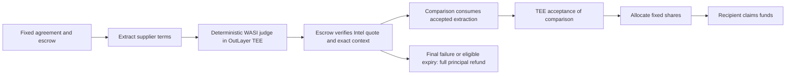

# Prooflane

**Two dependent agent tasks. One conditional settlement.**

A buyer funds a fixed agreement. Worker 1 extracts supplier terms; worker 2 must use that exact accepted output. NEAR escrow allocates the fixed worker shares only when every required task is accepted. Final failure or eligible expiry permits a full-principal refund. This is work acceptance across a dependency chain, beyond a spending firewall.

## Run the complete fixture demo — no keys or cloud services

Requires Node.js **24.16+** and pnpm. From a fresh clone:

```sh
pnpm install --frozen-lockfile
npm run dev:console
```

Open **http://127.0.0.1:4317/demo**, then **Open sample workflow**. No wallet, environment file, Gemini/NVIDIA key, Supabase account, Rust compiler or Testnet funds are needed for this mode. Dependencies are downloaded during installation; fonts and UI assets are local.

| Do X | See Y |
| --- | --- |
| Choose **Wrong total → repair → pass** | Incorrect arithmetic fails; corrected extraction passes; comparison binds the accepted artifact hash |
| Choose **Final failure → refund policy** | Revisions exhaust, the first task is rejected and the dependent task is blocked; no partial worker entitlement |
| Open **Evidence** | Per-check reasons, exact artifacts, agreement/policy hashes and persisted database events |
| Run `npm run security:check` | Application tests, TypeScript and syntax checks |

Fixture outcomes are local database results, not live AI execution, hardware proofs or payments. The demo guide separately labels actual Testnet receipts.

## Architecture



The agreement freezes recipients, allocations, task graph, deadline, source manifest and each policy hash. A model cannot change those rules or move escrow funds. Allocating credits and successfully withdrawing are separate financial states.

## What is proven — and what is not

| Capability | Evidence/status |
| --- | --- |
| Dependent fixture workflow, repairs, reports and failure blocking | Runnable locally without credentials |
| Escrow transfers, callbacks, reserves and adversarial financial paths | Rust/Sandbox tests; historical designated-verifier Testnet payout/refund evidence |
| Pinned WASI judge executes on OutLayer | Both historical tasks executed; independent Intel TDX verification passed |
| Current direct-proof escrow | `agentwork-tee-v2-arlosxq.testnet`, code-only upgraded to profile v3 for new orders; existing v2 orders retain their original trust profile |
| Fresh funded extraction | Real Gemini output, OutLayer proof and direct v3 escrow acceptance confirmed [on Testnet](https://explorer.testnet.near.org/transactions/7E5zcVnARw1URRebRTfC5Y7jTzgmxYhYZr67i26xSgi5) |
| Complete live success through withdrawal | **Two fresh Gemini calls**, fresh TEE executions, both direct contract acceptances, allocation and actual [0.001 NEAR withdrawal](https://explorer.testnet.near.org/transactions/9ggfPm7tztGa5gBMD4Qqfd6UWTQTDF6nT2JrRoMREmFc); no recorded-output replay in this run |
| Separate expiry/refund | Full 0.001 NEAR refund and successful callback on the same account under its earlier v2 profile; no separate live v3 rejection/refund is claimed |
| Production/public hosting and independent security audit | **Not claimed** |

The implemented verifier supports structured synthetic supplier sources: schema, source facts/quotes, arithmetic, eligibility, selection and exact predecessor bindings. It does not prove arbitrary document truth or unrestricted semantic correctness. The current on-chain demo uses one account for buyer/verifier/worker recipients. Escrow deployment-key authority remains a trust boundary.

## Where TEE is used

The Rust WASI judge runs the deterministic verification profile inside OutLayer. Before dispatch, the escrow commits the exact request. On return, `submit_tee_result` verifies Intel/DCAP proof, pinned measurements, judge/input/output hashes, task context and revision/time bounds. An off-chain verdict boolean cannot authorize acceptance. TEE attests execution of those rules; it does not make source data truthful.

Profile v3 freezes a two-entry allowlist of independently reviewed worker measurement digests. Other workers are rejected; current registry approval alone cannot expand it. Gemini generation is recorded by the operator, while TEE attests deterministic verification. The fixed profile has a collateral/runtime validity window. Review [TEE enforcement](docs/tee-escrow-stage4.md), [deployment](docs/testnet-deployment-stage5.md) and [current release gates](docs/release-roadmap.md) before attempting a live order. Earlier dated planning documents are historical.

See the [13 November validation and live receipts](docs/release-validation-2026-11-13.md). Build the current escrow with `cargo build --locked --manifest-path contracts/work-escrow/Cargo.toml --target wasm32-unknown-unknown --release --features tee-worker-v3` using the repository target flags. Default builds preserve historical v1. Never deploy with initialization on an existing escrow.

## Live mode and development

The optional PostgreSQL console is `npm run dev:console:postgres` on port 4318. It requires private server configuration, migrations and Intear wallet sign-in with an Ed25519 Full Access Testnet key. ML-DSA account keys are not supported by this login verifier. Disconnect signs out of this workspace; orders remain isolated by their original owner account. Live model calls are explicit; Gemini, NVIDIA and NEAR AI adapters exist. Provider names/access can change; judging the fixture demo must never require provider availability. No silent provider substitution occurs. Recorded outputs must be labeled replay, not live inference.

All Testnet transactions are separately reviewed and signed by the owner. CLI operator actions are not presented as one-click wallet UX. Do not rerun old funding commands or change funded deadlines. Local private artifacts and credentials are excluded from the source release.

See [operator runbook](docs/operator-runbook.md), [full technical report](docs/NEAR-Agent-Work-Complete-Project-Report-2026-11-12.md), [security review](docs/security-hardening-round-2.md), [agent probes and scope](docs/agent-security-probes-2026-11-11.md), and [demo script](docs/demo-script-release.md).

## Build provenance and dependencies

This repository contains the hackathon application, Rust escrow/WASI judge, tests and operator scripts. It uses Node.js/TypeScript, pg, Supabase Storage, near-sdk and Intel/DCAP-related Rust libraries; see the lockfiles. The fixture runtime uses Node's built-in SQLite. Third-party dependencies retain their licenses; the bundled font license is included with its assets. No claim is made that security probe toolkits such as garak or PyRIT themselves were executed.

## License and current checkpoint

Project source: MIT; bundled third-party assets/dependencies retain their own licenses. See [LICENSE](LICENSE) and [current release status](docs/CURRENT-STATUS.md).
