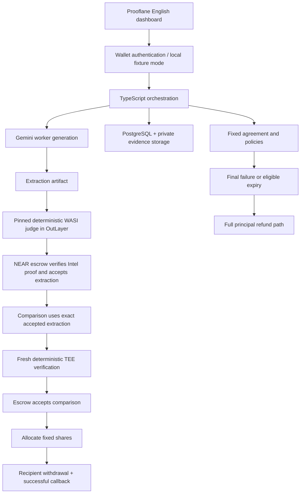

# گزارش جامع نهایی بیلد Prooflane

**تاریخ گزارش:** ۱۳ نوامبر ۲۰۲۶  
**نام فعلی محصول:** Prooflane — پروفلین  
**نام قبلی:** NEAR Agent Work / Verifiable Agent Work & Settlement Protocol  
**هدف:** گزارش مستقل و قابل‌ارسال دربارهٔ ایده، معماری، فعالیت‌های انجام‌شده، قابلیت‌های تکمیل‌شده، تست‌ها، شواهد و وضعیت نهایی MVP  
**ریپازیتوری عمومی:** https://github.com/ArlosX/near-  
**مجوز کد پروژه:** MIT؛ وابستگی‌ها و دارایی‌های ثالث تابع مجوز خود هستند  
**آخرین نقطهٔ مرجع کد پیش از این گزارش:** `285699c`

> این گزارش بر مبنای سورس فعلی و سوابق بررسی‌شدهٔ پروژه نوشته شده است. برای تهیهٔ گزارش، همهٔ تست‌ها یا تراکنش‌ها دوباره اجرا نشده‌اند. نتایج تاریخی با نتایج اجرای نهایی تفکیک شده‌اند. «تکمیل بیلد» در این سند به معنی تکمیل MVP و اثبات مسیر اصلی است؛ به معنی استقرار عمومی، ممیزی مستقل یا تکمیل سابمیت نیست. این سند جایگزین وضعیت‌های منقضی‌شدهٔ گزارش‌های قدیمی برای معرفی نسخهٔ فعلی است.

## ۱. جمع‌بندی وضعیت نهایی

Prooflane یک MVP عملیاتی برای اتصال انجام کار وابستهٔ عامل‌های هوش مصنوعی به پذیرش قابل‌بررسی و تسویهٔ مشروط روی NEAR است.

خریدار یک توافق ثابت تعریف می‌کند، دو کار وابسته اجرا می‌شوند، خروجی‌ها با قواعد از پیش مشخص بررسی می‌شوند و قرارداد تنها پس از پذیرش همهٔ کارهای ضروری اجازهٔ تخصیص سهم‌ها را می‌دهد. دریافت‌کننده سپس سهم خود را مطالبه می‌کند. شکست نهایی یا انقضای واجد شرایط، مسیر بازپرداخت اصل وجه را فعال می‌کند.

**مسیر اصلی نسخهٔ نهایی واقعاً تکمیل شده است:** دو پاسخ تازهٔ Gemini، دو اجرای تازهٔ OutLayer، پذیرش مستقیم اثبات Intel TDX برای هر دو خروجی در قرارداد، تخصیص سهم‌ها و برداشت موفق ۰٫۰۰۱ NEAR آزمایشی. این اجرا بازپخش پاسخ‌های قدیمی نبود.

بیلد شامل منطق دامنه، توافق و سیاست ثابت، orchestration، ذخیره‌سازی پایدار، شواهد خصوصی، اتصال مدل، قرارداد escrow، قاضی WASI، لایهٔ TEE، ورود با کیف پول، رابط انگلیسی چهارقسمتی، دموی بدون کلید و مستندات بازتولید است.

این نسخه یک سرویس تولیدی ممیزی‌شده یا بازار عمومی چندطرفه نیست. دامنهٔ اثبات‌شده، سناریوی محدود تأمین‌کننده با ورودی ساختاریافتهٔ مصنوعی و تسویهٔ Testnet است.

## ۲. مسئله و ارزش محصول

داشتن سقف خرج برای یک عامل، اثبات نمی‌کند که کار را درست انجام داده است. در کارهای چندمرحله‌ای، ممکن است مرحلهٔ دوم خروجی دیگری را مصرف کند، اطلاعات مرحلهٔ اول تغییر کند، محاسبات اشتباه باشند یا پرداخت پیش از تکمیل کل کار انجام شود.

Prooflane چهار سؤال را به هم وصل می‌کند:

1. دقیقاً چه کاری، با چه معیارهایی و چه سهم‌هایی توافق شده بود؟
2. هر عامل دقیقاً چه خروجی‌ای تحویل داد و چه چیزی بررسی شد؟
3. آیا مرحلهٔ بعد همان خروجی پذیرفته‌شدهٔ مرحلهٔ قبل را استفاده کرد؟
4. آیا کل کار، شرایط مالیِ از پیش ثابت‌شده را به دست آورد؟

تمایز اصلی پروژه «پرداخت در برابر نتیجهٔ پذیرفته‌شدهٔ یک زنجیرهٔ کار» است. محدودکردن مقصد پرداخت و بودجه می‌تواند مکمل آن باشد، اما جای بررسی نتیجه و وابستگی را نمی‌گیرد.

## ۳. سناریوی محدود و قابل‌دموی MVP

مثال عملی، بررسی پیشنهاد دو تأمین‌کننده است:

| مرحله | وظیفه | شرط عبور |
| --- | --- | --- |
| Extract & cite | استخراج قیمت، حمل، زمان تحویل و ارجاع از منابع پشتیبانی‌شده | ساختار، حقایق منبع و محاسبات معتبر باشند |
| Compare & select | مقایسه و انتخاب براساس خروجی پذیرفته‌شدهٔ استخراج | خروجی قبلی دقیقاً حفظ شود و گزینهٔ واجد شرایط انتخاب شود |

مرحلهٔ دوم تا پذیرش مرحلهٔ اول قفل می‌ماند. در مسیر زنده، اجرای وابسته پس از پذیرش استخراج روی زنجیره انجام شد. در دموی محلی، پذیرش محلی با برچسب مشخص نمایش داده می‌شود و ادعای پذیرش زنجیره‌ای ندارد.

در مثال نمونه، تعداد کالا ۲، بودجهٔ خرید ۲۵۰۰ سنت و سقف زمان تحویل ۷ روز است. پیشنهاد A با قیمت واحد ۱۰۰۰ سنت و حمل ۱۰۰ سنت، جمع ۲۱۰۰ سنت و تحویل سه‌روزه دارد. پیشنهاد B با جمع ۲۶۰۰ سنت و تحویل نامشخص، شرایط را احراز نمی‌کند. زمان تحویل نامعلوم، اثبات واجد شرایط بودن نیست.

بودجهٔ خرید کالا با حق‌الزحمهٔ عامل‌ها متفاوت است. ۰٫۰۰۱ NEAR آزمایشی، اصل escrow دموی مالی است؛ MVP واقعاً کالا نمی‌خرد.

## ۴. معماری نهایی



| لایه | پیاده‌سازی | نقش و مرز اختیار |
| --- | --- | --- |
| رابط | HTML، CSS، JavaScript؛ فونت محلی Space Grotesk | نمایش وضعیت واقعی، دریافت ورودی و شواهد |
| سرور | Node.js 24 و TypeScript | احراز هویت، API و هماهنگی؛ نتیجهٔ محلی جای نتیجهٔ قرارداد نیست |
| هسته | بسته‌های agreements، verification، orchestration و shared | قواعد دامنه، هش‌ها، بررسی خروجی و انتقال وضعیت |
| دیتابیس | PostgreSQL/Supabase برای محیط متصل؛ SQLite برای دمو و تست مستقل | ذخیرهٔ سفارش، گزارش، رویداد، نسخه و نتیجهٔ درخواست |
| شواهد | Supabase Storage خصوصی با ارجاع و بررسی هش | نگهداری بایت‌های منبع، artifact و گزارش |
| مدل | آداپتورهای Gemini، NVIDIA و NEAR AI | تولید خروجی؛ بدون اختیار پذیرش مالی یا جابه‌جایی پول |
| قاضی | Rust WASI با قواعد deterministic | بررسی پروفایل پشتیبانی‌شده در اجرای محلی و TEE |
| اجرا و اثبات | OutLayer و Intel TDX/DCAP | اجرای قاضی مشخص و تولید شواهد سخت‌افزاری |
| تسویه | قرارداد Rust با near-sdk روی NEAR Testnet | پذیرش مقید به توافق، تخصیص، برداشت، callback و بازپرداخت |

هویت عامل در سطح برنامه تعریف شده است؛ برای هر عامل یک قرارداد یا حساب مستقل ساخته نشده است. منطق صرفاً خارج از زنجیره بدون دلیل به عملیات روی زنجیره تبدیل نشده است.

## ۵. فعالیت‌های انجام‌شده در مسیر ساخت

### ۵.۱. تثبیت ایده و جلوگیری از افزایش بی‌دلیل دامنه

- تمرکز پروژه روی کار وابسته، توافق ثابت، بررسی قابل‌توضیح و تسویهٔ مشروط حفظ شد
- مثال دوکارۀ استخراج و مقایسه برای دموی کوتاه انتخاب شد
- افزودن marketplace، cross-chain، swarm و چندقاضی صرفاً برای نمایش پیچیدگی وارد MVP نشد
- ادعاهای رتبهٔ رقابتی و درصد آمادگی، جای خود را به شواهد قابل‌بررسی دادند

### ۵.۲. هستهٔ توافق و گردش کار

- توافق نسخه‌دار و نمایش snapshot ثابت پیاده شد
- گراف وابستگی، deadline، دریافت‌کننده‌ها، تخصیص‌ها، منابع و هش سیاست‌ها به توافق متصل شدند
- artifactها و گزارش‌ها نسخه‌دار و به هش بایت‌های دقیق متصل شدند
- حالت‌های شروع، ارسال، بررسی، اصلاح، پذیرش، شکست نهایی و انقضا ساخته شدند
- مصرف دقیق خروجی پذیرفته‌شدهٔ قبلی و جلوگیری از تغییر حقایق آن پیاده شد
- اختلاف نسخهٔ سفارش، درخواست تکراری و تکمیل دیرهنگام worker کنترل شدند

### ۵.۳. زیرساخت اجرا و ذخیره‌سازی

- ابزار Rust، محیط Linux/WSL و NEAR Sandbox برای ساخت و تست قرارداد آماده شدند
- اجرای محلی SQLite برای بازتولید بدون سرویس خارجی حفظ شد
- اتصال PostgreSQL/Supabase، تنظیم اتصال امن و migrationهای صریح آماده و آزمایش شدند
- ثبت اتمیک وضعیت، گزارش، رویداد و نتیجهٔ درخواست در SQL پیاده شد
- idempotency، قفل سفارش، lease، fencing و بازیابی محدود jobها اضافه شدند
- evidence خصوصی با دانلود مجدد و تطبیق هش، پیش از ثبت ارجاع معتبر پیاده شد
- راه‌اندازی سرور، migration و عملیات مدل از هم جدا شدند؛ startup به‌صورت پنهان migration اجرا نمی‌کند

### ۵.۴. قرارداد و مسیر مالی

- escrow، ثبت سفارش، پذیرش زیرکار، تخصیص سهم و برداشت ساخته شدند
- انقضا و بازپرداخت با کنترل وضعیت و callback پیاده شدند
- واریز، تخصیص اعتبار و انتقال واقعی وجه به‌عنوان مراحل متفاوت حفظ شدند
- مسیرهای اولیهٔ designated-verifier روی Testnet اجرا شدند
- سپس پذیرش مستقیم TEE به قرارداد اضافه شد و مسیر زندهٔ نهایی با آن تکمیل شد
- ارتقای code-only با حفظ سفارش‌ها و درخواست‌های معلق قبلی بررسی شد؛ initializer روی escrow موجود اجرا نشد

### ۵.۵. اتصال مدل‌ها

- آداپتورهای ارائه‌دهنده، حدود درخواست و پاسخ، timeout و تلاش محدود پیاده شدند
- رزرو تلاش پیش از I/O شبکه و نگهداری سوابق بدون Authorization/API key انجام شد
- مشکلات اتصال و دسترسی NVIDIA بررسی شدند؛ اجرای نهایی با Gemini انجام شد
- مدل فعلی در اجرای ثبت‌شده `gemini-3.5-flash-lite` بود؛ دسترسی آیندهٔ ارائه‌دهنده تضمین نشده است
- مدل نمی‌تواند recipient، سهم، deadline، verdict معتبر یا وضعیت پرداخت را تعیین کند
- پاسخ ثبت‌شدهٔ قدیمی با inference تازه یکی معرفی نشد؛ اجرای نهایی دو پاسخ تازه داشت

### ۵.۶. اتصال TEE و حل ناسازگاری worker

- قاضی deterministic در قالب Rust WASI برای OutLayer آماده شد
- ثبت درخواست دقیق پیش از اجرا و بررسی خروجی، context و proof در escrow پیاده شد
- تغییر identity اجرایی OutLayer باعث خطای worker measurements mismatch شد
- تلاش‌های هزینه‌دار بدون کنترل ادامه پیدا نکردند؛ هر دو identity بررسی شدند
- پروفایل v3 یک allowlist ثابت دوعضوی از measurementهای بررسی‌شده را برای سفارش تازه freeze می‌کند
- پروفایل سفارش‌های قبلی عوض نشد و registry approval به‌تنهایی مجوز اضافه‌کردن worker جدید نیست

### ۵.۷. ورود کیف پول و پایداری رابط

- ورود، خروج، reconnect و ماندگاری پس از refresh با Intear و حساب `arlosxq.testnet` آزمایش شدند
- محدودیت Ed25519 در ورود صریح شد؛ ML-DSA در این verifier ورود پشتیبانی نشده است
- نبود داده پس از پایان session از پاک‌شدن دیتابیس تفکیک و با ورود مجدد رفع شد
- سفارش‌ها به صاحب اصلی محدود ماندند و بین حساب‌ها جابه‌جا نشدند
- برچسب‌های نادرست قفل تسک در سفارش پرداخت‌شده، پس از خالی‌شدن cache صفحه اصلاح شدند
- سفارش نهایی اکنون پذیرش هر دو تسک و برداشت تأییدشده را به‌درستی نمایش می‌دهد

## ۶. بررسی خروجی و شواهد

بررسی deterministic فقط «قبول/رد» نیست؛ هر check انتظار، مقدار واقعی، نتیجه و توضیح دارد. بسته به نوع تسک، موارد زیر پوشش داده می‌شوند:

- schema و identity خروجی و نبود فیلدهای اضافیِ مجازنشده
- حقایق قیمت، حمل، تعداد، ارز و تحویل در دستور زبان ساختاریافتهٔ پشتیبانی‌شده
- پوشش منابع و وجود quotation در منبع freeze‌شده
- جمع هزینه و بازتولید محاسبات
- بودجه، تحویل و انتخاب واجد شرایط یا پاسخ معتبرِ نبود گزینه
- تطبیق dependency hash و حفظ دقیق حقایق استخراج پذیرفته‌شده
- اتصال گزارش به سفارش، وظیفه، نسخه، سیاست و خروجی مربوط

شواهد شامل توافق، artifact، گزارش‌ها، هش‌ها، سوابق مدل، timeline رویداد و رسیدهای زنجیره است. در UI، شناسهٔ تراکنش دیتابیس با تراکنش بلاکچین اشتباه معرفی نمی‌شود.

Storage خصوصی به معنی غیرقابل‌تغییر بودن مطلق مدیریتی یا ذخیره‌سازی غیرمتمرکز نیست. مدیر دارای دسترسی ممتاز می‌تواند شیء را تغییر دهد، ولی عدم تطابق هش باید کشف شود. آپلود شیء و commit SQL یک تراکنش توزیع‌شده نیستند؛ شکست SQL ممکن است شیء خصوصیِ بدون ارجاع باقی بگذارد، نه گزارش پذیرفته‌شده یا پرداخت معتبر.

## ۷. مرز اثبات TEE

TEE در نسخهٔ نهایی برای **اجرای بررسی deterministic** استفاده شده است، نه برای ادعای اثبات کل فرایند تولید زبان طبیعی.

قرارداد، اثبات را با بررسی‌های Intel/DCAP، امضا و وضعیت collateral/TCB و مقیدسازی به measurement، judge، input، output، درخواست، تسک، نسخه و زمان می‌پذیرد. مقدار boolean فرستاده‌شده از برنامه به‌تنهایی مجوز پذیرش نیست.

تمام پنج measurement مربوط به TDX در identityهای ثابت پوشش داده شده‌اند. identity ناشناخته خودکار پذیرفته نمی‌شود. پروفایل دارای پنجرهٔ اعتبار runtime/collateral است و اجرای آینده باید دوباره شرایط معتبر را احراز کند.

**آنچه ثابت نمی‌شود:** حقیقت هر سند دلخواه، صحت معنایی نامحدود، اجرای خود Gemini داخل TEE یا مستقل‌بودن governance و deployment key. ساختار منبع فعلی محدود و مصنوعی است.

## ۸. امنیت و عیب‌یابی انجام‌شده

### مرز وب و API

- اتصال origin و challenge ورود، nonce و تاریخ انقضا
- session سمت سرور با timeout بیکاری و عمر مطلق محدود
- بررسی مجدد مالکیت کلید برای درخواست‌های تغییر وضعیت و fail-closed در نبود RPC
- جلوگیری از بازیابی session پس از logout توسط پاسخ شبکهٔ دیررس
- محدودیت درخواست، header، حجم پاسخ و نرخ تلاش ورود
- کنترل Host، origin، Fetch Metadata، نوع JSON و mutation guard
- محدودیت frame، referrer، object و form متناسب با کنسول محلی
- cookieهای HttpOnly/SameSite؛ تنظیمات انتشار HTTPS عمومی هنوز کار جداست

### parser، مدل و integrity

- JSON مبهم با duplicate key، از جمله معادل Unicode-escaped، رد می‌شود
- UTF-8 نامعتبر پیش از decode/hash معتبر پذیرفته نمی‌شود
- یک نقص واقعی تبدیل بایت نامعتبر به replacement character بازتولید و اصلاح شد
- همین نوع سخت‌گیری برای envelope پاسخ provider نیز اعمال شد
- artifact نمی‌تواند فیلدهای اضافی برای verdict، مقصد پول، ابزار یا HTML وارد کند
- instructionهای حملهٔ appended به منابع خارج از grammar freeze‌شده رد شدند
- پیش از آماده‌سازی verdict جدید، شواهد بایگانی‌شده و وابستگی‌های پذیرفته‌شده دوباره بررسی می‌شوند

### مالی و TEE

- callbackهای خصوصی، حالت‌های pending/resolved و موفقیت واقعی انتقال بررسی شدند
- context جعلی، خروجی تغییرکرده، quote دستکاری‌شده و سوءاستفاده از proof بین پروفایل‌ها تست شدند
- حفظ وضعیت funded/pending در ارتقای قرارداد و قابلیت refund قبلی بررسی شد
- کلید افشاشدهٔ شناخته‌شدهٔ حساب قدیمی `arlos.testnet` در تراکنش `CsBoyyfftFGK1rzL1k4eV659R19JnHapfzojuEe6pggX` لغو و کلید جایگزین بررسی شد

### منابع و اسکن محدود

از الگوهای OWASP، NVIDIA garak و Microsoft PyRIT برای طراحی regressionهای محلی استفاده شد. خود toolkitهای garak و PyRIT اجرا نشدند؛ ادعای مصونیت مدل در برابر همهٔ prompt injectionها نداریم.

ProjectDiscovery Nuclei v3.11.1 با دو template رسمیِ بررسی‌شده روی محیط مجاز محلی اجرا شد. روی 4317 افشای git-config مشاهده نشد و چند header اطلاع‌رسانی شناسایی شد. CORP و X-Permitted-Cross-Domain-Policies اضافه و بررسی شدند. 4318 در زمان آن اسکن پاسخگو نبود؛ بنابراین پوشش اسکن احرازهویت‌شده برای آن ادعا نمی‌شود. HSTS مربوط به HTTPS عمومی است و COOP/COEP بدون بررسی سازگاری popup ولت اضافه نشدند.

این فعالیت‌ها hardening و تست هدفمند هستند، نه ممیزی مستقل، گواهی ASVS یا تضمین نفوذناپذیری.

## ۹. شواهد اجرای کامل زنده

**شبکه:** NEAR Testnet  
**قرارداد:** `agentwork-tee-v2-arlosxq.testnet`  
**پروفایل سفارش نهایی:** `outlayer-tdx-direct-v3`؛ v2 در نام حساب، نام تاریخی است  
**سفارش:** `demo-521ed9a3855a27a4f33b8a6a8ceba02a223ee69bc8b2d3ec`  
**هش توافق:** `sha256:ffd010bde440462c50f75a04c7ebb88330ef886cb461d2d52f14a9d94d32e551`  
**SHA-256 قرارداد:** `6f9607448a279d853e3ad95e8f59b4760ccd8110bde27bc9832d94ae9789e09f`  
**NEAR code hash:** `8WawYEgDE9erqwNJ2yhjJEnTobVbTm95vUbG7mkntsDx`

| مرحله | رسید Testnet |
| --- | --- |
| تأمین وجه | [H1TaUkfd…](https://explorer.testnet.near.org/transactions/H1TaUkfdTG7UabPiNYft7nyGhLVeSWq8MCs9sosbmiS4) |
| آماده‌سازی استخراج | [Bf9yW8z5…](https://explorer.testnet.near.org/transactions/Bf9yW8z5EGFHKdrFPoaPipZx8YXTmz9akpJtGCWYxCaC) |
| اجرای استخراج در TEE | [F2od1Ybw…](https://explorer.testnet.near.org/transactions/F2od1YbwXJxsRqmu7XZXwpBpN9jsYaHycVrAWhoBe1GY) |
| پذیرش استخراج | [7E5zcVnA…](https://explorer.testnet.near.org/transactions/7E5zcVnARw1URRebRTfC5Y7jTzgmxYhYZr67i26xSgi5) |
| آماده‌سازی مقایسه | [7f97jMq5…](https://explorer.testnet.near.org/transactions/7f97jMq5HsjikZf9UNan9c8DrqMcTGXe8J2M1CJ4G68K) |
| اجرای مقایسه در TEE | [7ZCrYrhb…](https://explorer.testnet.near.org/transactions/7ZCrYrhbw4o7D2mZZCK5hJFQ6dub3vKzPeADgYDXGQQ5) |
| پذیرش مقایسه | [CeLLRvsn…](https://explorer.testnet.near.org/transactions/CeLLRvsn1d7ykHKqajkqYGJxb9tVxeHhFZugMM976AQR) |
| تخصیص سهم‌ها | [C8KfnjTS…](https://explorer.testnet.near.org/transactions/C8KfnjTSa3utX1i3HAqJgTgJf5AWT1mQtmNpNGpiLY7L) |
| برداشت واقعی | [9ggfPm7t…](https://explorer.testnet.near.org/transactions/9ggfPm7tztGa5gBMD4Qqfd6UWTQTDF6nT2JrRoMREmFc) |

مقدار برداشت ۰٫۰۰۱ NEAR آزمایشی به دریافت‌کنندهٔ ثبت‌شده بود. تطبیق فراخوانی و مبلغ، operation متناظر، callback خصوصی موفق و نبود receipt شکست‌خورده در بررسی نهایی ثبت شده‌اند. وضعیت `SUCCESS_CREDITED` به‌تنهایی پرداخت واقعی معرفی نشد؛ رویداد تأیید برداشت جداگانه reconcile شد.

دو رویداد `model.response` برای این سفارش وجود دارد و `model.replay.imported` ندارد. پاسخ‌های provider با artifactهای تحویلی تطبیق داده شدند. این provenance تولید را در سطح سوابق اپراتور اثبات می‌کند، نه attestation سخت‌افزاری تولید مدل.

### بازپرداخت جداگانه

سفارش قبلیِ پروفایل v2 یعنی `demo-1ce52318c8f490f9e774cf1f7861e79dca901eb2bf23a27a` پس از ناتمام‌ماندن کار و انقضا، بازپرداخت کامل ۰٫۰۰۱ NEAR داشت:

[رسید بازپرداخت واقعی](https://explorer.testnet.near.org/transactions/2uWdqvtXxnFNzJPC6kCbaTBkJizAfM1SKS8mKAutiY94)

این شاهدِ expiry/refund تحت v2 است؛ شاهد اجرای تازهٔ rejected-output/refund تحت v3 نیست. اصل escrow بازپرداخت می‌شود؛ gas و هزینهٔ اجرای خارجی جزء اصل نیستند. همهٔ تلاش‌های تاریخیِ ناتمام، خودکار تسویه یا بازپرداخت‌شده فرض نشده‌اند.

## ۱۰. تست‌ها و سطح اعتبار نتایج

| گروه | نتیجهٔ ثبت‌شده | معنی و محدودیت |
| --- | --- | --- |
| application/security | ۱۱۷ تست پاس؛ TypeScript strict و syntax checks پاس | آخرین regression کامل در مرحلهٔ برند/تم دوباره پاس شد؛ تغییرات بصری بعدی در مرورگر بررسی شدند |
| crypto conformance نسخهٔ v3 | ۶ مورد پاس | هر دو identity معتبر؛ رد موارد تغییر proof/output و سوءاستفادهٔ بین پروفایل‌ها |
| Sandbox هدفمند روی artifact v3 | ۵ سناریو پاس | پرداخت واقعی در Sandbox، پروفایل ثابت، context جعلی، expiry/refund و حفظ v2 در ارتقا |
| مالی v2 | ۱۶ مورد پوشش داده شد | ۱۵ پاس در اجرای کامل و یک پاس هدفمند پس از اصلاح fixture تست؛ جدا از v3 |
| native state تاریخی | ۱۲ مورد پاس | نتیجهٔ تاریخی؛ به تعداد تست تازهٔ v3 اضافه نمی‌شود |
| PostgreSQL در round 2 امنیت | ۲۱ تست محلی پاس | با oracle محلی مالکیت کلید؛ اثبات تماس با ولت/RPC عمومی نیست |
| نصب clean-copy | نصب frozen-lockfile و اجرای بدون env پاس | قابلیت بازتولید در پوشهٔ جدا |
| smoke بدون کلید پس از برندینگ | ۱۱ asset، دو تسک و export شواهد پاس | دمو نمونه است؛ inference، TEE یا پرداخت زنده نیست |
| رابط | چهار route، theme، persistence، موبایل و وضعیت terminal بررسی شدند | کنترل بصری و دستی؛ ادعای audit کامل accessibility نیست |

تعدادهای مربوط به دوره‌های مختلف با هم جمع نمی‌شوند تا عدد بزرگ اما گمراه‌کننده ساخته نشود. fixture عمومی امکان بررسی سازگاری artifact، گزارش، dependency و receipt مشتق‌شده را می‌دهد؛ فایل fixture جای احراز اصالت RPC یا verifier واقعی Intel نیست.

## ۱۱. فرانت‌اند و هویت نهایی Prooflane

رابط از کنسول فارسی اولیه به داشبورد کاملاً انگلیسی تبدیل شد. طراحی با الهام از طرح مالک ساخته شد، سپس هویت نهایی Ice Blue × Graphite و نام Prooflane اعمال شدند.

### چهار بخش فعال

| بخش | امکانات |
| --- | --- |
| Overview | خلاصه، شمارنده‌های دادهٔ موجود، اقدام بعدی، سفارش‌های اخیر و مسیر پروتکل |
| Orders | فهرست سفارش‌های صاحب حساب، جست‌وجو، فیلتر، انتخاب و ساخت سفارش |
| Workflow | دو تسک وابسته، قفل/پذیرش، وضعیت مالی، اقدام بعدی و ابزارهای Advanced |
| Evidence | نتیجهٔ checkها، نسخهٔ گزارش، export، هش‌ها، timeline، تراکنش‌های دیتابیس و لینک رسیدهای Testnet |

### تغییرات تجربهٔ کاربری

- دریافت ورودی ساخت سفارش به مراحل بودجه، deadline و مرور توافق تقسیم شد
- جزئیات فنی به Advanced و Evidence منتقل شدند تا مسیر اصلی کوتاه بماند
- حالت disconnected، کاربر را با توضیح روشن به ورود کیف پول هدایت می‌کند
- خروج کیف پول، بازخوانی workspace و بازیابی پیش‌نویس ورودی اضافه یا تثبیت شدند
- تفاوت Sample، Local، accepted on-chain، allocated و Paid روشن شد
- hoverها تیره‌تر و شیشه‌ای‌تر می‌شوند و متن روشن‌تر می‌شود؛ حرکت سبک جای روشن‌شدن خشک را گرفت
- ورود کادرها، تغییرات بارگذاری و حرکت تعاملی با رعایت reduced-motion نرم شدند
- dropdown سفارشیِ شیشه‌ای، scrollbar هماهنگ و نمایش بهتر کادرهای inset اعمال شدند

### برند، تم و بکگراند

- نام نمایشی محصول، title تب، ورودی کیف پول و متن‌های معرفی به Prooflane تغییر کردند
- لوگوی SVG اختصاصی با مفهوم مسیر/حرف P/تأیید و favicon و manifest اضافه شدند
- نام حساب قرارداد، هش‌ها، شناسه‌ها، URL ریپو و داده‌های freeze‌شده برای برندینگ تغییر نکردند
- فونت محلی Space Grotesk حفظ شد
- حالت شب گرافیتی/آبی یخی و حالت روز سفید یخی/آبی یخی اضافه شدند
- کلید ماه/خورشید با حرکت نرم، label قابل‌دسترسی و ذخیرهٔ انتخاب در localStorage پیاده شد
- موج‌های بکگراند با SVG و کد، بدون ویدیو و وابستگی جدید، به‌صورت loop نرم حرکت می‌کنند
- توقف دستی بکگراند، توقف در tab مخفی و رفتار reduced-motion حفظ شدند
- سایدبار شفاف و دارای لبهٔ محوشونده شد؛ لایهٔ ثابت مورب و مرز صاف blur حذف شدند
- در اصلاح نهایی حالت روز، سفیدی کادرها و blur کمتر و رنگ موج‌ها واضح‌تر شد تا بکگراند از پشتشان دیده شود
- نقطهٔ پایان متن‌های نمایشی حذف شد؛ JSON، کد، URL، اعشار و دادهٔ فنی دست‌کاری نشدند

نسخه‌های برند/ظاهر روی main منتشر شدند: `084b24e`، `0f888cf` و `285699c`. آخرین مورد، اصلاح شفافیت حالت روز است.

## ۱۲. دمو، مستندات و انتشار سورس

دموی پیشنهادی ۲ تا ۳ دقیقه‌ای:

1. نمایش توافق ثابت و قفل مرحلهٔ دوم
2. نمایش یک خطای عددی واقعی در fixture و اصلاح آن
3. نمایش پذیرش واقعی استخراج با TEE و وابستگی مقایسه به همان خروجی
4. نمایش پذیرش مقایسه، تخصیص و رسید برداشت واقعی
5. نمایش بازپرداخت تاریخیِ جدا و مشخص‌کردن پروفایل آن
6. نمایش Evidence و دستور اجرای بدون کلید

README شامل تعریف کوتاه محصول، تفاوت با spending firewall، نمودار معماری، جدول Do X → See Y و بخش «چه چیزی اثبات شده و چه چیزی نه» است. اسکریپت ویدیوی کوتاه و پیش‌نویس X آماده‌اند، ولی آماده‌بودن متن به معنی انتشار ویدیو یا پست نیست.

انتشار سورس از bundle ایزوله و allowlist‌شده انجام شد؛ `.env`، private key، `artifacts/local`، دیتابیس و خروجی خصوصی وارد بستهٔ عمومی نشدند. secret scan و SOURCE-MANIFEST برای release استفاده شدند. انتشار از clone ایزوله انجام شد تا git ریشهٔ Desktop وارد انتشار نشود. انتشار عمومی به معنی انتشار سرویس روی هاست نیست.

### اجرای مجدد دموی مستقل

```sh
pnpm install --frozen-lockfile
npm run dev:console
```

آدرس: `http://127.0.0.1:4317/demo` و کنسول `http://127.0.0.1:4317`.

### محیط خصوصیِ متصل فعلی

```sh
npm run dev:console:postgres
```

آدرس محلی: `http://127.0.0.1:4318`. این حالت به تنظیمات خصوصی، دیتابیس آماده و ورود ولت نیاز دارد. تراکنش‌ها و اجرای مدل خودکار از صرفِ بازکردن صفحه شروع نمی‌شوند. کارهای زندهٔ TEE/تسویه هنوز مراحل صریح اپراتوری و امضای مالک دارند و one-click خودکار معرفی نشده‌اند.

## ۱۳. وضعیت پایان بیلد و کارهای باقی‌مانده

| مورد | وضعیت |
| --- | --- |
| هستهٔ MVP و توافق/وابستگی | پیاده‌سازی‌شده و تحت تست |
| ذخیره‌سازی و بستهٔ شواهد | پیاده‌سازی‌شده با مرزهای integrity مستند |
| اجرای تازهٔ عامل‌ها با Gemini | اجرای موفق ثبت‌شده |
| اجرای قاضی در TEE و پذیرش مستقیم قرارداد | برای هر دو تسکِ سفارش نهایی تأییدشده |
| تخصیص و برداشت واقعی v3 | تکمیل و reconcile شده |
| بازپرداخت | شاهد زندهٔ v2 و پوشش Sandbox؛ اجرای زندهٔ rejection/refund v3 ادعا نشده |
| رابط Prooflane و دو تم | پیاده‌سازی و بررسی‌شده؛ تأیید نهایی سلیقهٔ بصری با مالک |
| سورس عمومی و MIT | منتشرشده |
| هاست و دامنهٔ عمومی | انجام نشده؛ هدف جداگانهٔ بعدی |
| ویدیوی نهایی و پست عمومی X | متن/مسیر آماده؛ انتشار تأییدشده ثبت نشده |
| اطلاعات تماس و حساب mainnet دریافت جایزه | با مالک |
| فرم نهایی سابمیشن | به مرور شرایط روز و تأیید صریح payload توسط مالک نیاز دارد |
| پاک‌سازی مالی تمام تلاش‌های تاریخی | کامل‌بودن ادعا نمی‌شود؛ ممکن است امضای مالک لازم باشد |

برای هاست عمومی باید origin/HTTPS، cookie امن، اتصال کیف پول، کنترل مصرف چندکاربره و secretهای سرور در محیط مقصد تنظیم و تست شوند. کنسول loopback فعلی نباید بدون این کارها صرفاً روی اینترنت expose شود.

یک اجرای موفق end-to-end اثبات قابلیت MVP است، نه تضمین دسترس‌پذیری همهٔ اجراهای آینده. RPC، مدل و OutLayer سرویس بیرونی‌اند؛ deadline، اعتبار collateral، موجودی gas و worker identity همچنان باید برای اجرای تازه بررسی شوند.

## ۱۴. ارزیابی نهایی قابل‌دفاع

Prooflane از یک ایده و کنسول آزمایشی به MVP دارای سورس عمومی، رابط برندشده، دموی بازتولیدپذیر، بررسی توضیح‌پذیر، پذیرش مستقیم TEE و تسویهٔ واقعی Testnet رسیده است.

قوی‌ترین لحظهٔ ارائه این است: **مرحلهٔ دوم بدون پذیرش مرحلهٔ اول باز نمی‌شود، همان خروجی را مصرف می‌کند و پرداخت تنها بعد از پذیرش هر دو به حق مالی تبدیل می‌شود؛ برداشت واقعی هم رسید جدا دارد.**

فاز ساخت و اثبات مسیر اصلی MVP به نتیجه رسیده است. فاز انتشار عمومی، بسته‌بندی ارائه و ارسال نهایی هنوز باید با مالک بسته شود. جایگاه Top 5٪، امنیت مطلق، ممیزی مستقل و آمادگی تولید از شواهد موجود نتیجه گرفته نمی‌شوند.

## ۱۵. منابع داخلی برای بررسی جزئیات

- [README و راه‌اندازی](../README.md)
- [وضعیت release](CURRENT-STATUS.md)
- [تست‌ها و رسیدهای ۱۳ نوامبر](release-validation-2026-11-13.md)
- [manifest رسیدهای عمومی](../apps/test-console/public/release-evidence.json)
- [fixtureهای اجرای v3](../tests/fixtures/release-v3)
- [امنیت round 2](security-hardening-round-2.md)
- [probeهای امنیت عامل](agent-security-probes-2026-11-11.md)
- [اسکن محدود Nuclei](quick-security-scan-2026-11-11.md)
- [مدل ذخیرهٔ خصوصی شواهد](private-evidence.md)
- [runbook اپراتور](operator-runbook.md)
- [اسکریپت دموی کوتاه](demo-script-release.md)
- [تحویل سابمیشن](submission.md)

این گزارش هیچ کلید، رمز، عبارت بازیابی یا تنظیم محرمانهٔ اتصال را شامل نمی‌شود.
